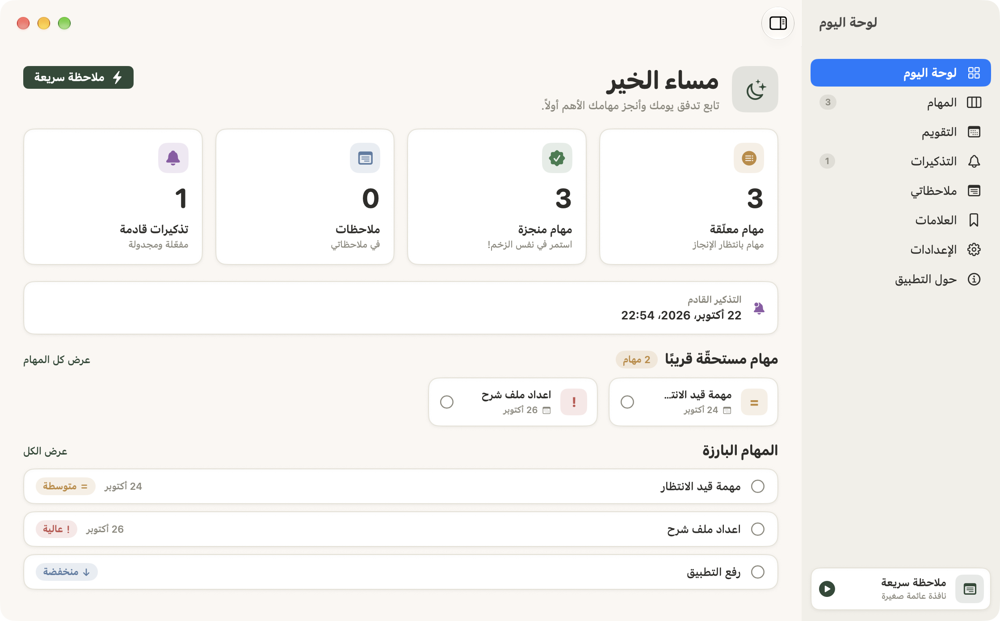
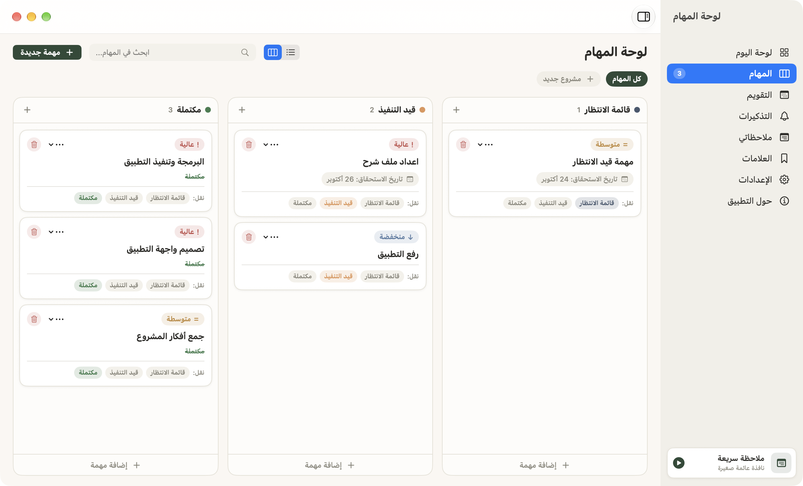
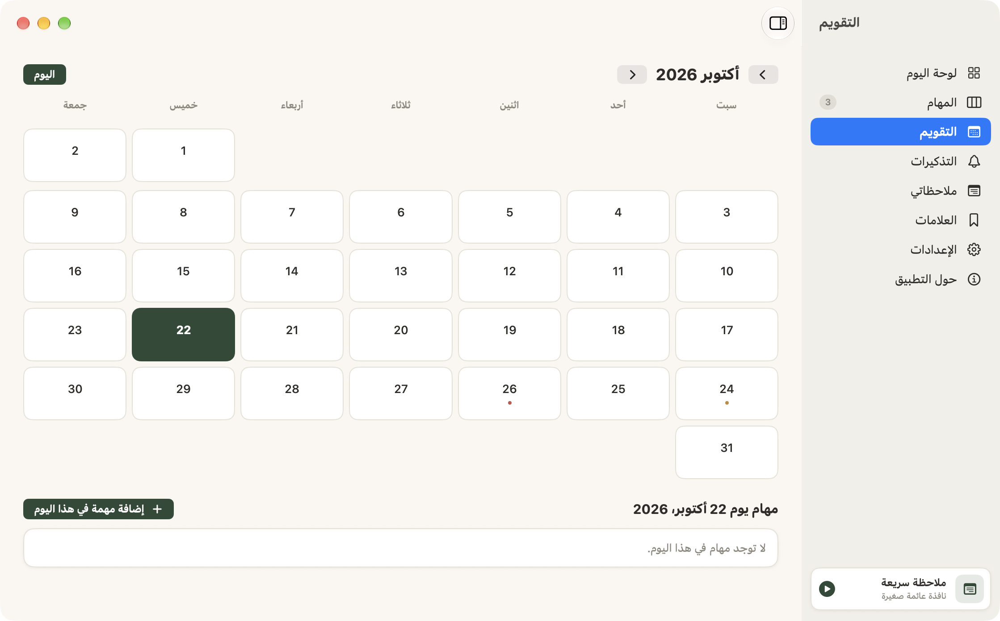
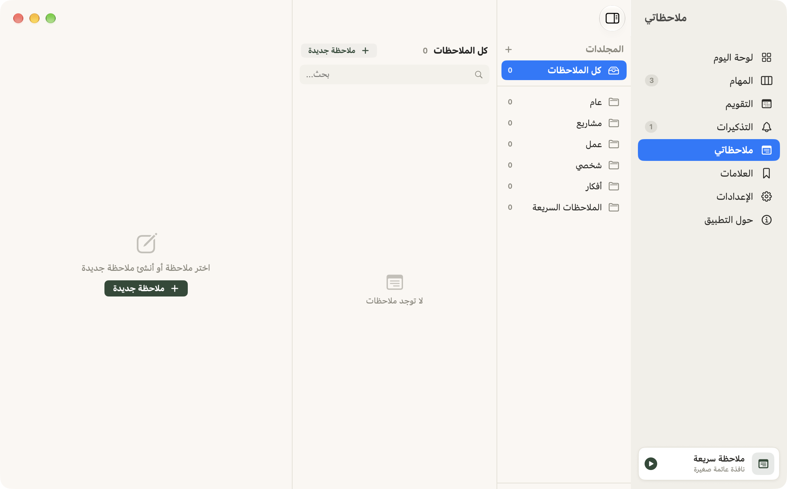
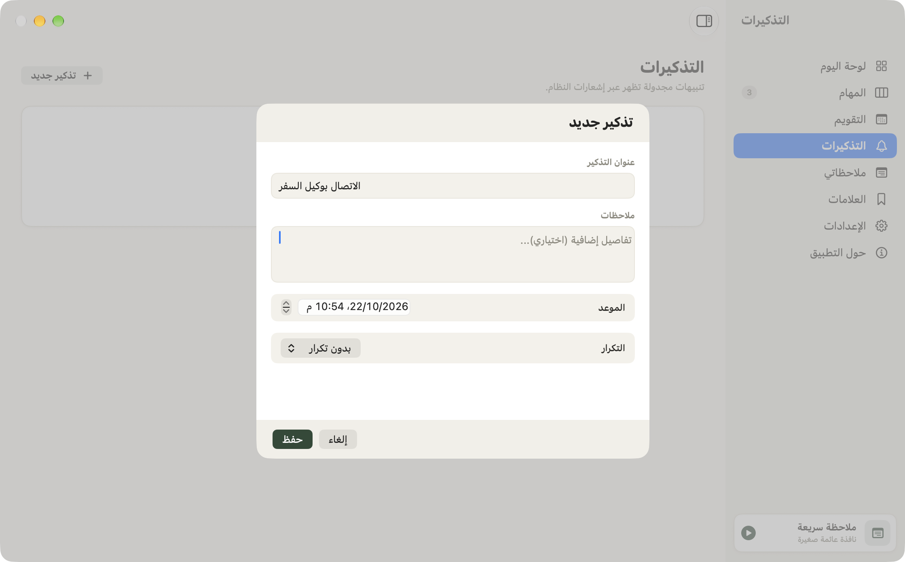
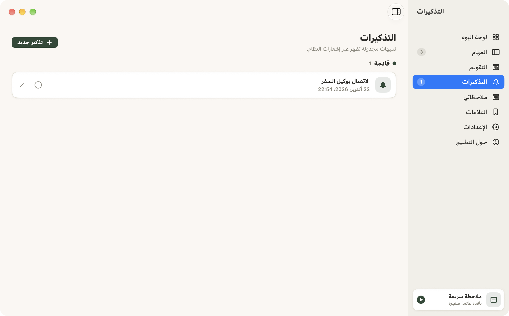
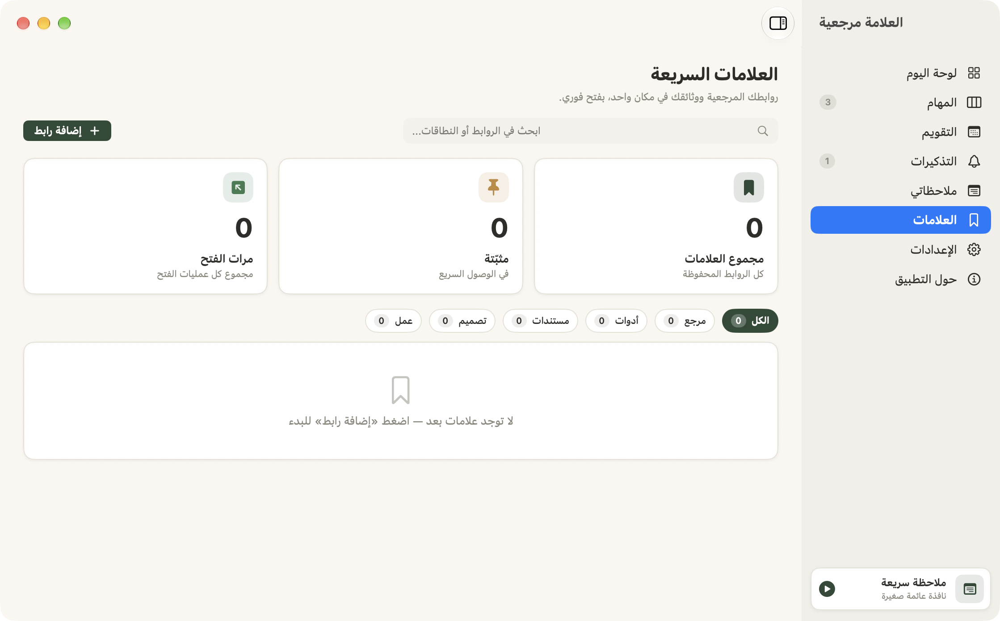
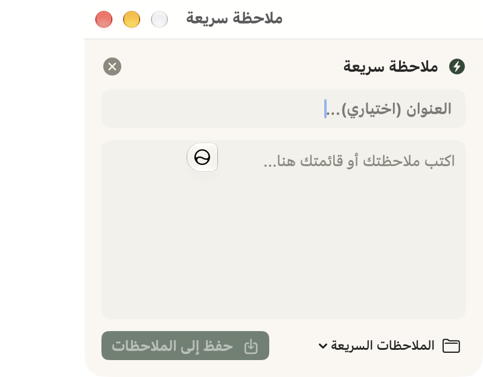
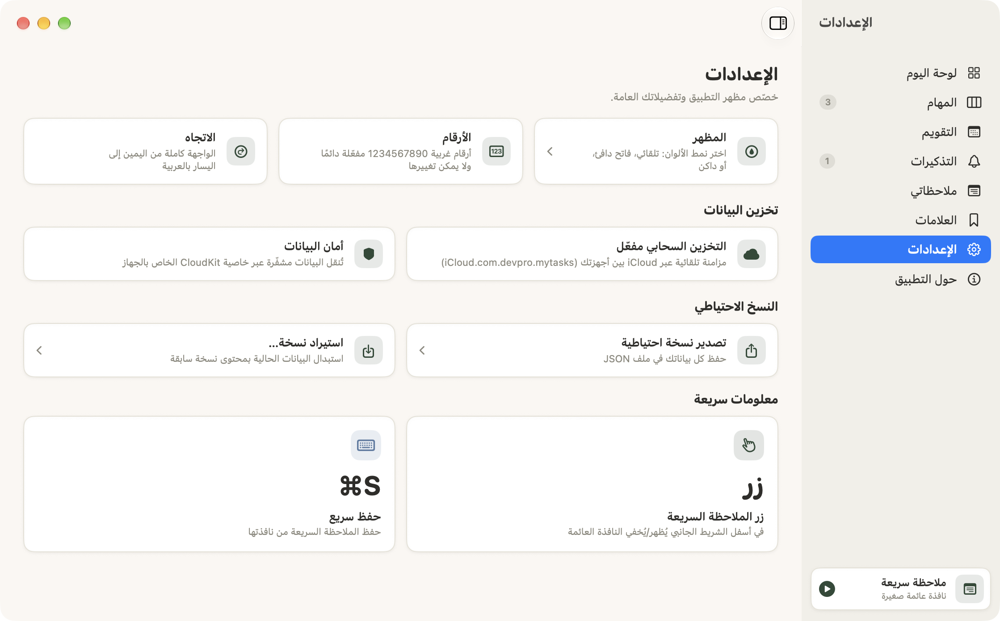
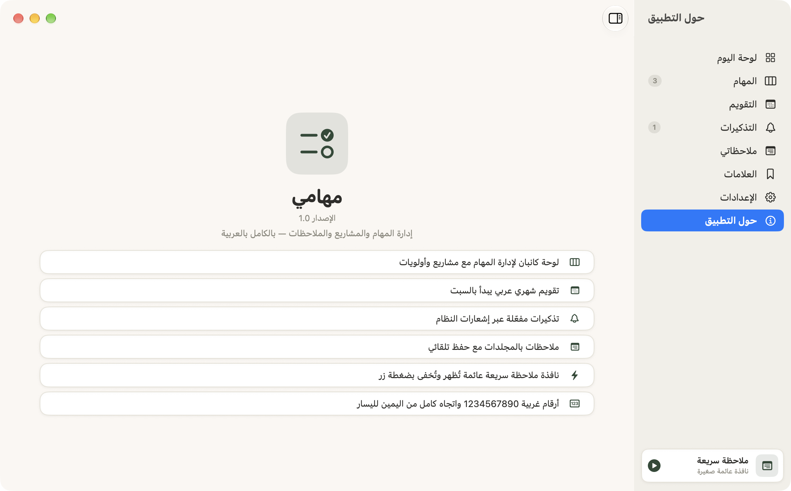

# مهامي 🗂️

منظم مهام وملاحظات شخصي لـ **macOS** — **عربي بالكامل (RTL)** — مبني بـ SwiftUI + SwiftData مع مزامنة **iCloud (CloudKit)**.

# إهداء إلى المستخدم العربي

### Thanks for OOMestre , original project : https://github.com/OOMestre/Focenda

## ✨ الميزات

- **اللوحة الرئيسية** — المهام البارزة والمستحقة قريبًا في نظرة واحدة
- **المهام** — لوحة كانبان (تطوير / نحو التنفيذ / مكتملة) + عرض قائمة، بترتيب ذكي: التاريخ ← الأولوية ← الأحدث
- **المشاريع** — تجميع المهام مع شريط تقدم حي
- **الملاحظات** — داخل مجلدات، والتحرير بالنقر المزدوج
- **التذكيرات** — تنبيهات النظام مع مواعيد مرنة
- **العلامات المرجعية** — روابط مصنفة مع عدّاد الزيارات والتعديل بالنقر المزدوج
- **ملاحظة سريعة** — نافذة عائمة تفتح بـ ⌘O وتحفظ تلقائيًا
- **مزامنة iCloud** — عبر حاوية CloudKit خاصة، مع تراجع محلي آمن
- **نسخ احتياطي** — تصدير/استيراد JSON كامل للبيانات
- **وضع داكن** — يتبع النظام في كل نافذة

## 🖼️ لقطات الشاشة

| | |
|:---:|:---:|
|  <br> **اللوحة الرئيسية** |  <br> **المهام (كانبان)** |
|  <br> **التقويم** |  <br> **الملاحظات** |
|  <br> **التذكيرات** |  <br> **تفاصيل التذكير** |
|  <br> **العلامات المرجعية** |  <br> **الملاحظة السريعة ⌘O** |
|  <br> **الميزات والإعدادات** |  <br> **حول التطبيق** |

## 🛠️ التقنيات

| | |
|---|---|
| الواجهة | SwiftUI |
| البيانات | SwiftData + CloudKit (CloudKit-backed container) |
| اللغة | Swift 5 / Swift Concurrency |
| الهدف | macOS 15+ |
| عربي | RTL كامل، أرقام غربية، سلسلة أدوات عربية مخصصة |

## 📦 البناء

```bash
cd "My Tasks"
xcodebuild -project "مهامي.xcodeproj" -scheme "مهامي" -configuration Debug build \
  -allowProvisioningUpdates
```

يتطلب البناء حساب Apple Developer لعمل المزامنة السحابية (CloudKit container: `iCloud.com.devpro.mytasks`).

## 📁 البنية

```
مهامي/
├── MyTasksApp.swift      # نقطة الإطلاق + مخطط البيانات + الترحيل
├── Classes/              # النماذج، المساعدات، النسخ الاحتياطي
├── Views/                # الشاشات (مهام، ملاحظات، تذكيرات، علامات، إعدادات، ملاحظة سريعة)
├── FormControls.swift    # عناصر واجهة مخصصة
└── مهامي.entitlements    # iCloud/CloudKit
AppStore/                 # معلومات جاهزة للنشر على App Store
```

## 📃 الترخيص

راجع ملف [LICENSE](مهامي/LICENSE).

---

صُنع بحب في الكويت 🇰🇼
